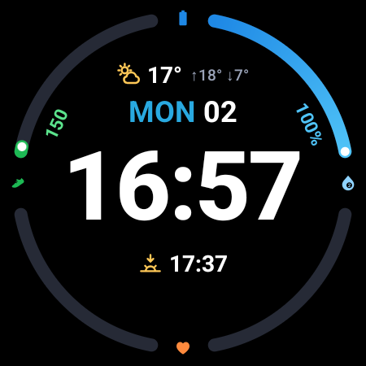
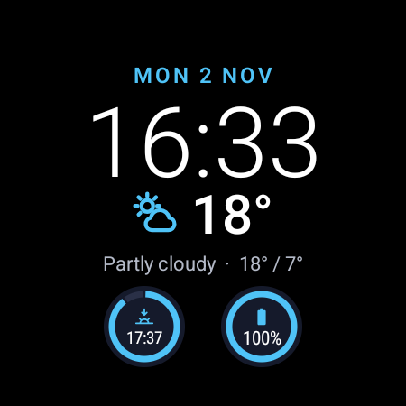

# WristLink

**Use a Samsung Galaxy Watch (Wear OS) with an iPhone.** Notifications with app icons and full
text, calls on the watch, music controls, a camera shutter, connection stats, a sleep quiet mode,
and an optional iPhone app for Apple Health and more.

Samsung and Google don't support Galaxy Watch 4 and newer on iPhone. WristLink makes them work by
talking to the Bluetooth services iOS already offers every accessory, the same way Garmin and
other wearables do, and adds an iPhone companion app for what iOS doesn't share on its own.

> WristLink is built on [WatchBridge](https://github.com/WasThatRudy/watchbridge) by Raj Tiwari.
> Its original documentation is in [docs/upstream-README.md](docs/upstream-README.md) and its
> plan in [docs/upstream-plan.md](docs/upstream-plan.md).

## What WristLink adds

WatchBridge is the base: iOS's notification and media services (ANCS, AMS) on Wear OS, call
alerts, the camera remote, the rest timer, in-app updates, the adb installers and the release
workflow. WristLink adds over 40 commits on top, about 11,400 lines in the watch app and a new
6,300-line iPhone app:

- **An iPhone app with its own link to the watch.** SwiftUI app that talks to a GATT service on
  the watch over the connection iOS already keeps for notifications, so the watch never has to
  advertise and the app keeps working in the background. Newline-framed JSON over MTU-sized
  notifications, with acknowledged batches so nothing is lost when the link drops
  ([protocol](docs/companion-protocol.md)).
- **A health platform on the watch**, on Wear OS Health Services: 90 days of history in SQLite,
  activity rings, resting heart rate against the normal range for age and sex, a sleep score,
  coaching alerts, tiles and complications.
- **Workouts:** Health Services exercise sessions with live screens, heart-rate zones, laps and a
  summary, recorded with their GPS route.
- **Apple Health sync** of samples, sleep and workouts with routes, deduplicated with HealthKit
  sync identifiers, and an iPhone dashboard with day, week and month charts (Swift Charts) that
  keeps history beyond the watch's 90 days.
- **Two watch faces** on the Jetpack Watch Face library, with the iPhone's weather built in and
  burn-in care for Always On; weather and daylight complications for any face.
- **Album art and app icons through the iPhone**, so the watch doesn't need Wi-Fi for them.
- **Measured, not guessed:** notification delay and link-drop stats on the watch; a low-power BLE
  connection interval that brought WristLink to 0.2% of an overnight drain (batterystats); an
  experiment that measured at 8% of a day was switched off.
- **iPhone builds without a Mac:** GitHub Actions on macOS runners build, ad-hoc sign and publish
  the app as a SideStore source, so the iPhone installs updates itself.
- **Versions from git** (`git describe` and the commit count), so a local build and the release
  of the same commit always agree and the watch's updater never offers a downgrade.
- **Its own name:** the package moved from `com.watchbridge` to `com.wristlink`, with a one-time
  hand-over of the watch's data from the old package (signature-checked provider) so nothing
  was lost.

## What works

| | Needs the iPhone app? |
|---|---|
| iPhone notifications on the watch, with title, text and app icon, usually under a second | No |
| Calls: ring on the watch, answer or decline, talk through the watch | No |
| Music controls for whatever plays on the iPhone (Spotify, Apple Music, ...) | No |
| Album art in the music controls, the media tile and the watch's own media controls | Yes |
| Camera shutter for the iPhone camera | No |
| iPhone battery level on the watch | No |
| Connection stats: notification delay, uptime, drops (Settings → Connection stats) | No |
| Quiet while asleep: Do Not Disturb and no raise-to-wake while the watch sees you sleep | No |
| Watch battery and stats on the iPhone, and every WristLink setting | Yes |
| App icons for apps the watch hasn't seen, without Wi-Fi on the watch | Yes (else the watch's Wi-Fi) |
| Weather and sunrise/sunset: a tile, and complications for any watch face that takes them | Yes |
| Two WristLink watch faces with the weather built in (see below) | Weather: yes |
| Health on the watch: activity rings, heart rate, sleep score, tiles and complications ([below](#health)) | No |
| Workouts on the watch: run, walk, hike, bike, rowing and more, with heart-rate zones and laps | No |
| Apple Health sync: steps, heart rate, sleep, workouts with their GPS route | Yes |
| Health dashboard on the iPhone with day, week and month charts and months of history | Yes |

Not possible on iPhone for any third-party watch: replying to messages, call history, Apple Pay.

Tested on a **Galaxy Watch4 Classic (SM-R890), One UI 8 Watch / Wear OS 6**, with an iPhone on iOS 26.
Should work on other Galaxy and Wear OS watches.

## Watch faces

WristLink comes with two watch faces; pick them in the watch face list like any other.

| WristLink Dashboard | WristLink |
|---|---|
|  |  |

**Dashboard** has four gauges around the rim (steps, battery, heart rate and blood oxygen to
start with), the weather from the iPhone with today's high and low at the top, and the next
sunrise or sunset under the time. Touch and hold it to pick other data for the gauges and the
slot, or a single accent color. **WristLink** is the quieter one: the time, the weather and two
round slots. Both draw only once a second with the screen on and once a minute on Always On.

## Health

The watch keeps 90 days of activity, heart rate and sleep itself, from the sensors Wear OS
shares (Health Services), and works it out the way Samsung Health does:

- **Today:** three rings for moving, active time and calories (each one picks what it counts:
  steps or floors, active or exercise minutes, ...) against your goals, and the day hour by hour.
- **Heart rate:** live, the day's range, and resting heart rate against the normal range for
  your age and sex.
- **Sleep:** time asleep, awake stretches and a 0–100 score, from the watch's own sleep detection.
- **Workouts:** live screens, heart-rate zones, laps, and a summary afterwards.
- **Coaching:** a nudge after 50 minutes sitting, alerts for a heart rate that stays too high or
  too low at rest, step goal reminders and badges.
- **Tiles and complications** for activity, heart rate and sleep, on any watch face.

The iPhone app writes all of it to Apple Health and shows it on its Health tab: tap a card for
its history by day, week or month. The iPhone keeps every day it has seen, so the history goes
back further than the watch's 90 days.

Samsung Health's own numbers (its sleep stages, blood oxygen, ECG, stress) stay in Samsung Health;
it doesn't share them with other apps.

## Install

### Watch

You need a computer with [adb](https://developer.android.com/tools/releases/platform-tools) once.
The watch and the computer must be on the same Wi-Fi.

1. On the watch: **Settings → About watch → Software → tap Software version** until developer mode
   is on, then **Settings → Developer options → ADB debugging** and **Wireless debugging** on.
2. Run the installer and follow it (it pairs adb, installs the latest release and grants the
   permissions a watch has no screen for):
   - macOS / Linux: `bash scripts/install.sh`
   - Windows: `scripts\install.bat`
3. On the watch, open **WristLink → Start pairing**. On the iPhone, open **Settings → Bluetooth**
   and tap **WristLink** (it can be listed twice; either works). Allow notifications when asked.

Turn off Bluetooth on any Android phone the watch was set up with while pairing, or Wear OS may
hide the watch from the iPhone.

### Updates

The watch updates itself: **WristLink → Settings → Updates** checks this repository's latest
[release](https://github.com/slymn08183/WristLink/releases/latest) over Wi-Fi. The first
update after installing with adb asks you to confirm it on the watch; later ones install on
their own. On the iPhone, updates come through SideStore (see below).

The permissions the installer grants, for reference:

```sh
dumpsys deviceidle whitelist +com.wristlink                 # stay connected in the background
cmd appops set com.wristlink RUN_ANY_IN_BACKGROUND allow
cmd appops set com.wristlink REQUEST_INSTALL_PACKAGES allow  # in-app updates
pm grant com.wristlink android.permission.ACTIVITY_RECOGNITION    # sleep detection
cmd notification allow_dnd com.wristlink                          # quiet while asleep
pm grant com.wristlink android.permission.WRITE_SECURE_SETTINGS   # watch settings from WristLink / iPhone
cmd appops set com.wristlink WRITE_SETTINGS allow
pm grant com.wristlink android.permission.BODY_SENSORS              # heart rate (Wear OS 6 also: health.READ_HEART_RATE)
```

### iPhone app (optional)

No Mac needed: it is built on GitHub and installed with SideStore (or AltStore, Sideloadly). See [ios/README.md](ios/README.md).

## Battery

WristLink itself used **0.2%** of the watch's overnight drain in a measured night (batterystats).
The link to the iPhone runs at a low-power Bluetooth interval (120 ms). Sleep comes from the
watch's own detection, so nothing is polled (watches without it fall back to reading the step
counter every 10 minutes at night). Weather tiles and complications get a whole timeline of hours
and sunrise/sunset at once and don't wake the watch to update. On a Galaxy Watch most overnight drain comes from Samsung
Health's sleep measurements (blood oxygen especially), Bluetooth and the screen.

## Roadmap

- **Don't buzz while the iPhone is in use**, like an Apple Watch: an experiment reads whether the
  iPhone's screen is on from its Bluetooth advertisements; nothing is held back yet.
- **iPhone app:** ring phone / ring watch, camera preview.

## Project layout

```
app/        Wear OS app (Kotlin, Compose for Wear OS)
ios/        iPhone companion app (SwiftUI, generated with XcodeGen)
scripts/    Watch installers
docs/       Protocol, release process, health plan, upstream documentation
```

Watch builds: `./gradlew assembleDebug` (installs next to the release app as
`com.wristlink.debug`). Every push to `master` that changes the watch app publishes a signed
release (`v1.x.y`) that the watch's updater picks up; versions come from git, so a local build
and the release of the same commit agree. See [docs/RELEASING.md](docs/RELEASING.md).

iPhone builds run in GitHub Actions (`.github/workflows/ios.yml`) and land in the
[`ios-latest`](https://github.com/slymn08183/WristLink/releases/tag/ios-latest) pre-release,
which SideStore offers as an update.

The watch ↔ iPhone protocol is in [docs/companion-protocol.md](docs/companion-protocol.md).

## License

MIT, see [LICENSE](LICENSE). Based on WatchBridge, © 2026 Raj Tiwari.
